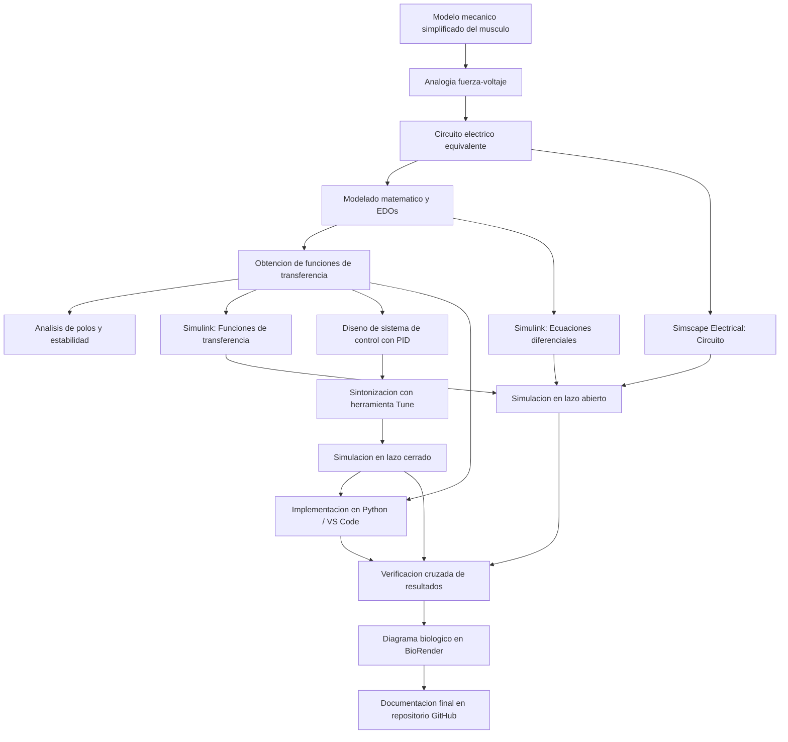

[](https://matlab.mathworks.com/open/github/v1?repo=soriano-23212231/MSFP3)
# Práctica 3 — Modelado y control del sistema musculoesquelético
Repositorio académico de la asignatura **Modelado de Sistemas Fisiológicos**, correspondiente al programa de **Ingeniería Biomédica** del Tecnológico Nacional de México / Instituto Tecnológico de Tijuana[cite: 1, 10, 11, 12]. Esta práctica integra el modelado viscoelástico, analogías electromecánicas mediante la analogía fuerza-voltaje, análisis temporal y de estabilidad, diseño de controladores clásicos (PID), simulación computacional (*in silico*) y verificación cruzada de resultados.

El caso de estudio representa un **modelo mecánico simplificado del sistema musculoesquelético** basado en la formulación de Khoo. Se busca modelizar, simular y controlar la respuesta dinámica de un compartimento muscular comparando el estado de un individuo sano (control) con un caso simulado de atrofia muscular, evaluando la estrategia de control orientada a reducir las diferencias entre ambas respuestas.

**Docente:** Dr. Paul Antonio Valle Trujillo  
**Correo:** paul.valle@tectijuana.edu.mx  
**Departamento:** Ingeniería Eléctrica y Electrónica  
**Institución:** Tecnológico Nacional de México / Instituto Tecnológico de Tijuana  
**Asignatura:** Modelado de Sistemas Fisiológicos  
**Programa:** Ingeniería Biomédica  
**Estudiante:** Judith Valeria Soriano Angeles · 23212231 · l23212231@tectijuana.edu.mx

**Repositorio de la asignatura:** https://github.com/DrPaulValle/MSF-IBF1020  
**Sede:** Blvd. Alberto Limón Padilla s/n, Tijuana, C. P. 22454, B. C., México.

<a id="contenido"></a>
## Contenido

1. [Resumen](#resumen)
2. [Competencia y objetivos](#objetivos)
3. [Relación con el temario](#temario)
4. [Modelo mecánico y analogía electromecánica](#analogia)
5. [Formulación matemática](#modelo)
6. [Análisis temporal y de estabilidad](#analisis)
7. [Condiciones de simulación y parámetros](#senales)
8. [Implementación en MATLAB, Simulink y Simscape Electrical](#matlab)
9. [Control en lazo cerrado y sintonización PID](#pid)
10. [Reproducción en Python](#python)
11. [Ilustración biológica en BioRender](#biorender)
12. [Resultados y verificación cruzada](#resultados)
13. [Flujo de trabajo](#flujo)
14. [Actividades de la estudiante](#actividades)
15. [Estructura del repositorio](#estructura)
16. [Requisitos](#requisitos)
17. [Reproducibilidad y entregables](#reproducibilidad)
18. [Referencias](#referencias)

---

<a id="resumen"></a>
## Resumen

La práctica tiene como propósito **analizar, simular y controlar un modelo mecánico simplificado del sistema musculoesquelético** mediante técnicas de control clásico y analogías físicas. El comportamiento viscoelástico del tejido se describe utilizando elementos contráctiles, amortiguadores viscosos y resortes (elementos en paralelo y en serie). Mediante la analogía **fuerza-voltaje**, el sistema mecánico se transforma en un circuito eléctrico equivalente, lo que facilita su formulación matemática en ecuaciones diferenciales, obtención de funciones de transferencia y experimentación *in silico*.

Se estudian dos condiciones fisiológicas: un **individuo sano (control)** y un **caso simulado de atrofia muscular**, este último representado por un incremento significativo en la resistencia $R$ del amortiguador. Utilizando la respuesta del individuo sano como referencia, se diseña e implementa un sistema de control con retroalimentación empleando un controlador PID, sintonizado para aproximar la respuesta del caso a la del control. Los resultados obtenidos en MATLAB/Simulink y Simscape Electrical se corroboran mediante un cuaderno computacional y un script en Python, complementándose con una ilustración detallada en BioRender.

**Palabras clave:** Sistema musculoesquelético; Analogía fuerza-voltaje; Modelo viscoelástico; Atrofia muscular; Controlador PID; Simscape Electrical; BioRender.

[Volver al contenido](#contenido)

---

<a id="objetivos"></a>
## Competencia y objetivos

### Competencia a desarrollar

Modeliza sistemas fisiológicos mediante analogías entre sistemas físicos, ecuaciones diferenciales y funciones de transferencia para analizar su comportamiento dinámico y diseña estrategias de control mediante técnicas de control clásico. En particular, durante la práctica se analiza un modelo mecánico simplificado del sistema musculoesquelético, se construye su circuito eléctrico equivalente mediante la analogía fuerza-voltaje, se compara la respuesta de un individuo sano (control) con un caso simulado de atrofia muscular y se diseña una estrategia de control *in silico* orientada a reducir las diferencias entre ambas respuestas.

### Objetivo general

Modelar, simular y controlar la dinámica de un sistema musculoesquelético mediante su representación mecánica, analogía electromecánica, análisis matemático y diseño de control en lazo cerrado, corroborando su consistencia a través de MATLAB, Simulink, Python y BioRender.

### Objetivos específicos

1. Analizar el modelo mecánico simplificado del sistema musculoesquelético compuesto por elementos contráctiles, amortiguadores y resortes.
2. Construir el circuito eléctrico equivalente mediante la analogía fuerza-voltaje considerando las correspondencias entre componentes mecánicos y eléctricos.
3. Formular el modelo matemático de ecuaciones diferenciales ordinarias y calcular la función de transferencia del sistema.
4. Aplicar el análisis matemático inicial mediante el principio de superposición y la transformada de Laplace para obtener las funciones de transferencia del individuo sano (control) y del caso simulado de atrofia muscular (caso).
5. Implementar la simulación *in silico* del sistema en MATLAB/Simulink y Simscape Electrical evaluando la respuesta en lazo abierto.
6. Diseñar y sintonizar un controlador PID en Simulink utilizando la herramienta Tune para reducir el error entre la respuesta del caso de atrofia muscular y la referencia del individuo sano.
7. Desarrollar un cuaderno computacional en MATLAB y un script complementario en Python para verificar, graficar y contrastar los resultados de la simulación.
8. Ilustrar mediante un diagrama biológico en BioRender la relación entre las estructuras del sistema musculoesquelético, el modelo mecánico y su equivalente eléctrico.

[Volver al contenido](#contenido)

---

<a id="temario"></a>
## Relación con el temario

La práctica integra contenidos correspondientes a las unidades fundamentales de la asignatura **Modelado de Sistemas Fisiológicos (IBF-1020)**:

| Unidad | Área | Contenidos aplicados |
|---|---|---|
| I | Sistemas de control retroalimentados | Diagramas de bloques, señales de referencia, análisis de error en estado estacionario y estrategias de control clásico |
| II | Modelado matemático | Analogías entre sistemas físicos y eléctricos, leyes de equilibrio mecánico, obtención de modelos y funciones de transferencia |
| III | Controladores | Diseño y sintonización de controladores PID para la mejora del desempeño dinámico de sistemas biológicos |

[Volver al contenido](#contenido)

---

<a id="analogia"></a>
## Modelo mecánico y analogía electromecánica

El sistema musculoesquelético se representa mediante el modelo mecánico viscoelástico de Khoo[cite: 1], el cual incluye una fuerza activa $F_0(t)$ desarrollada por el elemento contráctil, un amortiguador viscoso ($R$) que representa la disipación del tejido, y elementos elásticos en paralelo ($C_p$) y en serie ($C_s$) asociados con la compliancia del sarcolema y los tendones[cite: 1].

Para facilitar el análisis circuital, se utiliza la **analogía fuerza-voltaje**, estableciendo las siguientes correspondencias[cite: 1]:

| Sistema mecánico | Sistema eléctrico equivalente |
|---|---|
| Fuerza $F(t)$ | Voltaje $V(t)$ |
| Velocidad $\frac{dx(t)}{dt}$ | Corriente $I(t)$ |
| Desplazamiento $x(t)$ | Carga eléctrica $q(t)$ |
| Amortiguador | Resistencia $R$ |
| Compliancia mecánica | Capacitancia $C$ |
| Masa | Inductancia $L$ |

### Parámetros del circuito equivalente (Control vs. Caso)

Para simular las condiciones fisiológicas, se emplean los siguientes valores en el circuito eléctrico equivalente[cite: 1]:

| Parámetro | Control (Individuo sano) | Caso (Atrofia muscular) | Unidad eléctrica |
|---|---:|---:|---|
| $F(t)$ | $1$ | $1$ | $\mathrm{V}$ |
| $C_p$ | $100$ | $100$ | $\mu\mathrm{F}$ |
| $C_s$ | $10$ | $10$ | $\mu\mathrm{F}$ |
| $R$ | $100$ | $10\,000$ ($10\,\mathrm{k}$) | $\Omega$ |

La diferencia entre el individuo sano y el caso de atrofia muscular se modela mediante el incremento de la resistencia $R$, representando la alteración en el comportamiento viscoso del tejido[cite: 1].

[Volver al contenido](#contenido)

---

<a id="modelo"></a>
## Formulación matemática

1. **Ecuaciones de equilibrio y del sistema:** A partir de las restricciones mecánicas del modelo de elementos en serie y paralelo, y aplicando las leyes constitutivas correspondientes, se obtienen las ecuaciones diferenciales ordinarias que rigen el desplazamiento y la fuerza transmitida.
2. **Función de transferencia:** Aplicando la transformada de Laplace con condiciones iniciales nulas y el principio de superposición, se determina la función de transferencia del sistema expresada en términos del desplazamiento de salida respecto a la fuerza aplicada[cite: 1]:
   $$G(s) = \frac{X(s)}{F(s)}$$
3. Se obtienen de manera independiente las funciones de transferencia para la condición de **control** y de **caso** sustituyendo sus respectivos parámetros paramétricos[cite: 1].

[Volver al contenido](#contenido)

---

<a id="analisis"></a>
## Análisis temporal y de estabilidad

- **Análisis de estabilidad:** Se determinan los polos de las funciones de transferencia para los modelos de control y caso, evaluando su ubicación en el plano complejo para garantizar la estabilidad del sistema y analizar el efecto del incremento del amortiguamiento equivalente sobre la dinámica transitoria[cite: 1].
- **Error en estado estacionario:** Se define la señal de error para el sistema de control como la diferencia entre el desplazamiento de referencia del individuo sano y el del caso[cite: 1]:
  $$e(t) = x_{\text{control}}(t) - x_{\text{caso}}(t)$$
  Analizando analíticamente el comportamiento final para evaluar el rendimiento del esquema de retroalimentación[cite: 1].

[Volver al contenido](#contenido)

---

<a id="senales"></a>
## Condiciones de simulación y parámetros

Las simulaciones se ejecutan en el intervalo temporal $t \in [0, 10]\,\mathrm{s}$[cite: 1]. Se evalúa la respuesta al impulso unitario y escalón según corresponda para contrastar el comportamiento en lazo abierto del individuo sano frente a la atrofia muscular, así como la efectividad del controlador PID implementado[cite: 1].

[Volver al contenido](#contenido)

---

<a id="matlab"></a>
## Implementación en MATLAB, Simulink y Simscape Electrical

El desarrollo computacional abarca tres formas de representación en el entorno MATLAB/Simulink[cite: 1]:
1. **Modelo matemático en Simulink:** Implementado a partir de las ecuaciones diferenciales del sistema[cite: 1].
2. **Función de transferencia en Simulink:** Implementada mediante bloques de función de transferencia directa para control y caso[cite: 1].
3. **Simscape Electrical:** Construcción del circuito eléctrico equivalente utilizando componentes pasivos ($R$ y $C$) para verificar la analogía electromecánica[cite: 1].

### Cuaderno computacional (`.mlx`)
Permite automatizar la ejecución de los modelos en Simulink, almacenar las respuestas en el *Workspace* y generar gráficos comparativos de las condiciones de control, caso en lazo abierto y caso con controlador, guardando los resultados automáticamente en formato PDF[cite: 1].

[Volver al contenido](#contenido)

---

<a id="pid"></a>
## Control en lazo cerrado y sintonización PID

Se implementa un esquema de control por retroalimentación empleando un bloque **PID Controller** en la rama del paciente (caso), utilizando la respuesta del individuo sano como señal de referencia[cite: 1]. 

- **Sintonización:** Mediante la herramienta **Tune** del bloque PID en Simulink, se ajustan las ganancias $k_P$, $k_I$ y $k_D$ para lograr una respuesta estable y minimizar el error dinámico[cite: 1].
- **Análisis en lazo cerrado:** Se compara gráficamente la evolución temporal entre $x_{\text{control}}(t)$, $x_{\text{caso}}(t)$ y $x_{\text{PID}}(t)$, evaluando cambios en amplitud, velocidad de respuesta y amortiguamiento[cite: 1].

[Volver al contenido](#contenido)

---

<a id="python"></a>
## Reproducción en Python

Como parte de la verificación cruzada, se implementa un script en Python utilizando **Visual Studio Code**[cite: 1]:
- Definición de las funciones de transferencia para control y caso.
- Simulación de la respuesta al impulso bajo los mismos parámetros de MATLAB[cite: 1].
- Integración de las ganancias $k_P$, $k_I$ y $k_D$ obtenidas en Simulink para simular el lazo cerrado del caso[cite: 1].
- Generación y almacenamiento de las figuras comparativas entre ambas plataformas[cite: 1].

[Volver al contenido](#contenido)

---

<a id="biorender"></a>
## Ilustración biológica en BioRender

Se desarrolló un diagrama biológico en BioRender que vincula de forma directa los componentes abstractos del modelo con las estructuras reales del sistema musculoesquelético[cite: 1], identificando:
- Elemento contráctil muscular activo $F_0(t)$[cite: 1].
- Estructuras elásticas musculares y tendinosas ($C_p$ y $C_s$)[cite: 1].
- Comportamiento viscoso del tejido ($R$)[cite: 1].
- Desplazamientos $x(t)$ y $x_1(t)$ junto con la fuerza generada $F(t)$[cite: 1].

[Volver al contenido](#contenido)

---

<a id="resultados"></a>
## Verificación cruzada y resultados

La verificación cruzada compara de manera consistente las respuestas obtenidas mediante[cite: 1]:
1. Las ecuaciones del sistema en Simulink[cite: 1].
2. Las funciones de transferencia en Simulink[cite: 1].
3. El circuito eléctrico en Simscape Electrical[cite: 1].
4. El cuaderno computacional de MATLAB[cite: 1].
5. El código fuente en Python[cite: 1].

### Archivos de resultados gráficos incluidos (`.pdf`)
- Respuestas en lazo abierto (Comparativa Control vs. Caso).
- Respuestas del sistema controlado con PID sintonizado.
- Figuras exportadas desde MATLAB y Python.

[Volver al contenido](#contenido)

---

<a id="flujo"></a>
## Flujo de trabajo


[Volver al contenido](#contenido)

---

<a id="actividades"></a>
## Actividades de la estudiante

**1. Identificación del modelo mecánico:** Análisis de elementos contráctiles, amortiguadores, resortes y restricciones de fuerza y desplazamiento.
**2. Construcción de la analogía electromecánica:** Conversión del modelo mecánico en un circuito eléctrico equivalente utilizando la analogía fuerza-voltaje.
**3. Formulación de las ecuaciones del sistema:** Aplicación de las relaciones constitutivas y leyes de equilibrio para describir la dinámica del sistema musculoesquelético.
**4. Obtención de la función de transferencia:** Aplicación de la transformada de Laplace y el principio de superposición para determinar la función de transferencia para las condiciones de control y caso.
**5. Análisis del error en estado estacionario:** Determinación analítica de la respuesta final y evaluación del efecto producido por el incremento de $R$.
**6. Análisis de estabilidad:** Cálculo y representación de los polos en el plano complejo para determinar la estabilidad de cada modelo.
**7. Implementación en MATLAB/Simulink:** Construcción de los modelos por ecuaciones, función de transferencia y circuito equivalente en Simscape Electrical.
**8. Análisis de la respuesta en lazo abierto:** Determinación de la respuesta al impulso unitario y análisis de las características temporales ante la variación de $R$.
**9. Construcción del sistema de control:** Implementación del diagrama de bloques en Simulink utilizando la respuesta del individuo sano como referencia y agregando el controlador PID.
**10. Sintonización del controlador PID:** Ajuste de las ganancias $k_P$, $k_I$ y $k_D$ mediante la herramienta Tune para reducir el error con respecto a la referencia.
**11. Análisis de la respuesta en lazo cerrado:** Simulación y comparación de $x_{\text{control}}(t)$, $x_{\text{caso}}(t)$ y $x_{\text{PID}}(t)$.
**12. Análisis computacional mediante MATLAB:** Desarrollo del cuaderno computacional para ejecutar simulaciones, almacenar respuestas y exportar las figuras en formato PDF[cite: 1].
**13. Implementación mediante Python:** Programación de las funciones de transferencia y sistemas en lazo cerrado utilizando Visual Studio Code para corroborar los resultados[cite: 1].
**14. Verificación cruzada de los resultados:** Contrastación consistente entre las distintas implementaciones (Simulink, Simscape, MATLAB y Python)[cite: 1].
**15. Elaboración del diagrama biológico:** Creación de una ilustración en BioRender que relaciona los elementos del modelo con las estructuras anatómicas del sistema musculoesquelético[cite: 1].
**16. Documentación y resguardo de resultados:** Creación del repositorio en GitHub con la estructura organizada de archivos, el archivo README.md y el archivo CITATION.cff[cite: 1].

---

<a id="estructura"></a>
## Estructura del repositorio

```text
.
├── README.md                      # Reporte de la práctica (este archivo)
├── CITATION.cff                   # Información de citación del repositorio
├── SorianoAngeles_Practica3.mlx   # Cuaderno computacional de MATLAB
├── SorianoAngeles_Practica3.pdf   # Versión PDF del cuaderno de MATLAB
├── modelo_musculoesquelético.slx  # Modelo de Simulink y Simscape Electrical
├── script_musculo.py              # Script de verificación en Python
├── analisis_matematico.pdf        # Análisis matemático y superposición a mano
├── diagrama_biologicorender.pdf   # Ilustración del sistema en BioRender
└── figuras/                       # Resultados gráficos en formato PDF
    ├── control_caso_lazo_abierto.pdf
    ├── sistema_controlado_pid.pdf
    └── verificacion_python.pdf
```

[Volver al contenido](#contenido)

---
<a id="requisitos"></a>
## Requisitos

### Software

- **MATLAB** y **Simulink**, con el modelo y el cuaderno de referencia.
- **Simscape Electrical**, para construir el circuito de componentes eléctricos.
- Herramientas de Simulink para diseño y sintonización del bloque **PID Controller**.
- **Python** y **Visual Studio Code** para ejecutar el programa suministrado.
- Las bibliotecas Python que importe efectivamente el código de referencia.
- **Git y GitHub** para organizar y presentar el repositorio de la práctica.

[Volver al contenido](#contenido)

---
<a id="reproducibilidad"></a>
## Reproducibilidad y entregables

### Secuencia de reproducción

1. Consultar el [repositorio general de la asignatura](https://github.com/DrPaulValle/MSF-IBF1020) y descargar los materiales y archivos de referencia proporcionados para la práctica[cite: 1].
2. Analizar el modelo mecánico simplificado del sistema musculoesquelético y su representación viscoelástica mediante elementos contráctiles, amortiguadores y resortes[cite: 1].
3. Construir el circuito eléctrico equivalente utilizando la analogía fuerza-voltaje y verificar la selección de los valores para la condición de control y el caso de atrofia muscular[cite: 1].
4. Desarrollar el análisis matemático inicial mediante el principio de superposición y la transformada de Laplace para obtener las funciones de transferencia de control y caso[cite: 1].
5. Implementar y ejecutar las simulaciones en MATLAB/Simulink y Simscape Electrical evaluando la respuesta en lazo abierto[cite: 1].
6. Construir el diagrama de bloques en Simulink para el sistema de control con retroalimentación, incorporando el controlador PID en la rama del caso[cite: 1].
7. Sintonizar las ganancias $k_P$, $k_I$ y $k_D$ del controlador PID utilizando la herramienta Tune para aproximar la respuesta del caso a la referencia del individuo sano[cite: 1].
8. Ejecutar el cuaderno computacional de MATLAB (`.mlx`) para simular los modelos, almacenar las respuestas en el *Workspace* y exportar las gráficas comparativas en formato PDF[cite: 1].
9. Implementar las funciones de transferencia y el sistema en lazo cerrado en Python (utilizando Visual Studio Code) para corroborar y contrastar los resultados obtenidos en MATLAB[cite: 1].
10. Elaborar el diagrama biológico en BioRender relacionando las estructuras anatómicas con los componentes del modelo mecánico y eléctrico[cite: 1].
11. Organizar todas las evidencias, análisis, códigos, cuadernos y figuras en el repositorio de GitHub documentando los resultados en este archivo `README.md` junto con el archivo `CITATION.cff`[cite: 1].

### Resultados mínimos esperados

| Entregable | Evidencia solicitada |
|---|---|
| Análisis mecánico | Interpretación de elementos contráctiles, amortiguadores y resortes |
| Analogía electromecánica | Conversión mediante la analogía fuerza-voltaje y equivalencias de parámetros |
| Análisis matemático | Modelo de ecuaciones, aplicación de superposición y funciones de transferencia para control y caso |
| Análisis de estabilidad y error | Localización de polos en el plano complejo y evaluación del error en estado estacionario |
| Simulaciones *in silico* | Modelo en Simulink/Simscape Electrical y respuestas en lazo abierto |
| Sistema de control y sintonización | Implementación del lazo de retroalimentación y obtención de ganancias PID con Tune |
| Cuaderno de MATLAB | Cuaderno interactivo `.mlx`, su exportación a `.pdf` y almacenamiento de Workspace |
| Verificación en Python | Script `.py` implementado en Visual Studio Code y validación cruzada de respuestas |
| Diagrama biológico | Ilustración detallada elaborada en BioRender vinculando anatomía y modelo |
| Documentación final | Archivo `README.md` completo, metadatos en `CITATION.cff` y repositorio organizado en GitHub |

[Volver al contenido](#contenido)

---
